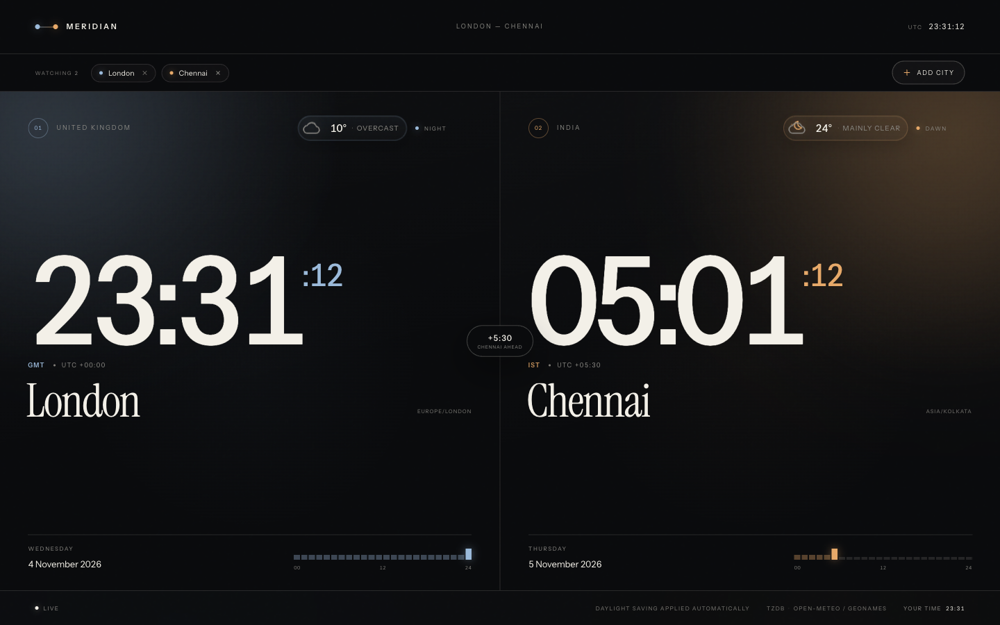
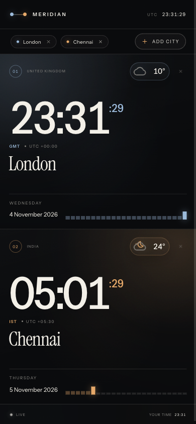

<h1 align="center">Meridian</h1>

<p align="center"><strong>World clocks that feel like a place — not a spreadsheet.</strong></p>

<p align="center">Pin any city or time zone. See the local time, the weather outside, and how far apart your day really is.</p>

<p align="center">
  <a href="https://deneshashok.github.io/meridian-world-clock/"><strong>Open the live canvas →</strong></a>
</p>

<p align="center">
  
</p>

<p align="center">
  <a href="https://deneshashok.github.io/meridian-world-clock/"></a>
  
  
  
</p>

Most world clocks stop at the time. Meridian sets a scene.

London and Chennai open the canvas. From there, pin the cities that shape your day — New York for the stand-up, Tokyo for the launch, Sydney for the weekend — and see every time, sky, and offset together. The result is part clock, part weather window, and part quiet dashboard for the rest of the world.

No account. No API key. No build pipeline. Just a static site that is ready the moment it loads.

## What it offers

### Build a world view that fits your life
Search by city, country, abbreviation, or IANA zone. Meridian bundles **317 time zones across 247 countries and regions**, with human aliases such as `Delhi`, `Bombay`, `NYC`, and `IST`. Add as many zones as you need — the canvas reflows from one to four columns and keeps every selected panel in view.

Your selection is remembered on the device, so the same world greets you when you return.

### Read the day, not just the hour
Each panel pairs the time with **current conditions from Open-Meteo**: temperature, condition, day or night, and a hand-drawn scene icon. Sun, moon, cloud, rain, snow, fog, and thunder each carry a small, restrained animation, so the weather reads at a glance without becoming a toy.

Readings are cached for ten minutes. If a refresh fails, the last known reading stays visible with a stale marker; if there is no reading at all, the panel says so clearly instead of inventing data.

### See the distance between days
With two zones, the centre badge shows the current difference. With three or more, every panel shows its delta from the first zone. Planning a call across five time zones becomes a glance instead of arithmetic.

### Trust the clock
Clock values come from the browser's `Intl` API, so daylight-saving changes are handled where they actually live — on the device. Panels show the active abbreviation, UTC offset, and 24-hour track, with no server clock to drift out of sync.

### Designed to stay open
The interface is built as a dark editorial canvas: oversized serif city names, precise mono utility labels, per-zone accent colours, and motion that supports the information rather than competing with it. It scales from a wide monitor to a phone, respects `prefers-reduced-motion`, and uses locally hosted fonts.

### Private by default
No analytics. No accounts. No trackers. Your zone selection stays in `localStorage`, and the only outbound request is the weather lookup for the cities you have pinned.

## A few ways to use it

- **A team wall display** — keep the offices, the on-call engineer, and the client across the world in one view.
- **Travel planning** — see the time and the weather before you pack.
- **Family and friends abroad** — know when it is a good moment to call.
- **Markets and operations** — watch session opens and handoffs without opening five tabs.
- **A stream or dashboard companion** — a calm, readable world view for a second screen.
- **A design reference** — a compact example of editorial layout, container queries, and motion with very little JavaScript.

Try searches like `Reykjavík`, `Cape Town`, `Delhi`, `NYC`, or `IST`.

## Responsive by design

<p align="center">
  
</p>

The same canvas becomes a single-column stack on small screens. Weather conditions step back before the clock or city name loses room, so the important information stays legible.

## Run it

```bash
docker compose up --build -d
```

Open [http://localhost:8080](http://localhost:8080).

Stop the container with:

```bash
docker compose down
```

Prefer a quick preview without Docker:

```bash
cd site && python3 -m http.server 8080
```

## Under the hood

- **Vanilla JavaScript** — no framework, no bundler, no runtime dependencies.
- **CSS Grid + container queries** — the layout adapts to the panel, not only the viewport.
- **Inline SVG weather scenes** — animated with CSS and reduced-motion aware.
- **Bundled data** — time-zone metadata and city coordinates ship with the site.
- **nginx in Docker** — static files, gzip, sensible cache headers, and security headers.
- **GitHub Pages** — the static site is published from a dedicated `gh-pages` branch.

## Project structure

```text
.
├── site/
│   ├── index.html              page structure and city picker
│   ├── styles.css              layout, typography, motion, responsive grid
│   ├── app.js                  clocks, weather, search, selection, persistence
│   ├── assets/fonts/           self-hosted Instrument Sans and Instrument Serif
│   └── data/
│       ├── timezones.js        bundled tzdb metadata and aliases
│       ├── places.js           bundled city coordinates for weather lookup
│       ├── LICENSE-tzdb.txt    tzdb attribution
│       └── NOTICE-weather.txt  Open-Meteo and GeoNames attribution
├── docs/                       screenshots used in this README
├── Dockerfile
├── docker-compose.yml
├── nginx.conf
└── README.md
```

## Data & attribution

- Time-zone metadata is derived from [@vvo/tzdb](https://github.com/vvo/tzdb) and distributed under the MIT license. See [`site/data/LICENSE-tzdb.txt`](site/data/LICENSE-tzdb.txt).
- Weather comes from [Open-Meteo](https://open-meteo.com/).
- City coordinates are derived from [GeoNames](https://www.geonames.org/) `cities15000` and `cities5000`, with small curated coordinates for remote stations and islands.

Open-Meteo and GeoNames data are licensed under [CC BY 4.0](https://creativecommons.org/licenses/by/4.0/). Full attribution is in [`site/data/NOTICE-weather.txt`](site/data/NOTICE-weather.txt).

## License

MIT — see [LICENSE](LICENSE).
